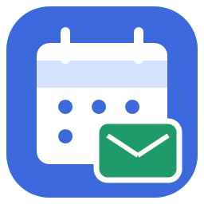
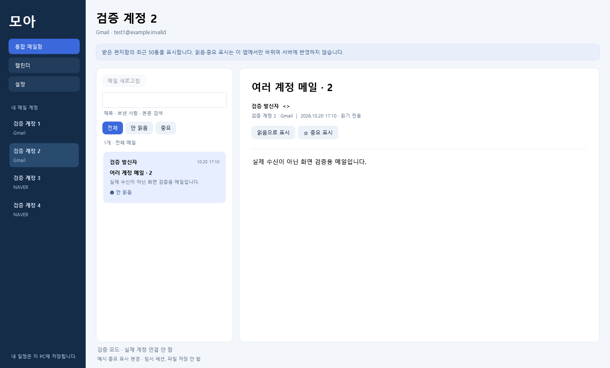

<div align="center">
  
  <h1>모아</h1>
  <p>여러 계정의 메일과 캘린더, Windows에서 한곳에.</p>
  <p><a href="https://github.com/SCOTT0318/moa-calendar/releases/tag/v1.0.0">설치 파일 받기</a> · <a href="INTEGRATION.ko.md">계정 연결 안내</a> · <a href="https://github.com/SCOTT0318/moa-calendar/issues">문제 신고</a></p>
</div>

**Windows 11 x64 · v1.0.0 초기 배포판**

Google 2개 이상과 네이버·하이웍스 여러 계정을 구분해서 사용할 수 있는 Windows 앱입니다. 메일·캘린더 조회와 알림, 트레이 실행을 제공합니다. **실제 사용자 계정 로그인·수신은 아직 검증하지 않았습니다.** 자동 검증은 모의 HTTP 응답·합성 메일·WPF 화면과 설치 프로그램을 대상으로 합니다. 네이버 CalDAV의 Windows 연결은 시험 지원입니다.



## 설치와 실행

1. [릴리스](https://github.com/SCOTT0318/moa-calendar/releases/tag/v1.0.0)에서 **Moa-Setup.exe**를 받습니다.
2. 설치하면 시작 메뉴의 **모아**와 바탕화면 바로가기로 실행할 수 있습니다. .NET 런타임이 포함되어 별도 설치가 필요 없습니다. 관리자 권한 없이 현재 사용자에게 설치합니다.
3. **설정 → 내 계정**에서 Google·네이버·하이웍스를 추가합니다. 같은 버튼으로 두 번째, 세 번째 계정도 추가합니다.
4. 작업표시줄에 계속 두려면 실행 중인 모아 아이콘을 오른쪽 클릭해 **작업 표시줄에 고정**을 선택합니다. 실행 아이콘과 바로가기는 같은 앱 ID·아이콘을 사용합니다.

별도 설치가 싫다면 **Moa-win-x64.zip**을 풀어 `Gather.exe`를 실행하세요. 폴더 전체를 보관해야 합니다. 실행본·설치 프로그램은 **코드 서명되지 않았습니다**. 서명이나 SmartScreen 신뢰를 획득한 배포로 표시하지 않습니다. 파일 비교용 SHA-256은 `SHA256SUMS.txt`에 제공합니다.

## 무엇을 할 수 있나요?

| 기능 | 지원 범위 |
|---|---|
| 여러 Google 계정 | 계정마다 별도 로그인·토큰, 선택 창에서 다른 계정 추가 |
| 여러 네이버 계정 | 아이디·앱 비밀번호를 계정별로 구분 |
| 하이웍스 메일 | POP3 받은 편지함·서버 원본 유지 |
| 통합 메일함 | 각 계정의 최근 50통, 검색·계정별 필터·본문 조회 |
| Google 캘린더 | 계정에 등록된 읽기 가능한 캘린더 목록과 일정 |
| 네이버 캘린더 | CalDAV로 기간 조회, Windows 실계정 호환 미검증 |
| 일정 표시 | 종일·여러 날·반복·예외·취소 처리, 출처 구분 |
| 내 일정 | 같은 날의 시간 일정 추가·수정·삭제 |
| 새 메일 알림 | 최초 조회 후 들어온 안 읽은 메일을 2분마다 확인 |
| 일정 알림 | 시작 0~60분 전, 기본 10분 전, 중복 억제 |
| 트레이 실행 | 창을 닫아도 계속 확인, 아이콘 두 번 클릭으로 복원 |

메일 발송·삭제, 서버 읽음/별표 변경, 외부 일정 수정은 하지 않습니다. 앱의 읽음·중요 표시는 이번 실행의 표시 상태입니다. 외부 이미지·스크립트는 실행하지 않으며 메일 본문은 텍스트로 표시합니다. 첨부파일 열기·저장과 폴더별 메일 탐색은 지원하지 않습니다. 큰 네이버·하이웍스 메일은 헤더만 표시하고 웹 메일에서 확인하도록 안내합니다.

한 계정에서 조회에 실패하면 그 계정의 이전 데이터를 유지하고 오류를 표시하며 다른 계정은 계속 확인합니다. 새 계정을 연결하거나 앱을 다시 시작할 때 기존 메일을 새 메일로 몰아서 알리지 않습니다. 앱을 완전히 종료하면 알림도 중단됩니다. 앱이 실행 중일 때 표시하는 자체 알림창이며 Windows 알림 센터에 쌓이는 알림은 아닙니다.

## 계정 연결

- **Google**: Google Cloud에서 Gmail API·Calendar API를 활성화하고 OAuth 동의 화면과 테스트 사용자를 설정합니다. **데스크톱 앱**용 클라이언트 JSON을 처음 한 번 선택합니다. 다음 계정은 같은 OAuth 앱 설정을 재사용해 시스템 브라우저에서 다른 계정으로 로그인합니다. 선택한 기능의 읽기 권한만 요청하며, 테스트 중인 OAuth 앱은 연결할 두 Google 계정을 모두 테스트 사용자로 등록해야 합니다.
- **네이버**: 네이버 메일에서 IMAP을 켜고, 2단계 인증과 앱 비밀번호를 설정합니다. 계정 추가 창에서 메일·캘린더를 선택합니다. 캘린더만 연결할 경우 CalDAV 계정 정책을 따릅니다. 네이버 공식 CalDAV 안내는 iOS·Mac 기준이므로 Windows 실계정에서 호환 확인이 필요합니다.
- **하이웍스**: 회사에서 외부 메일 사용을 허용해야 합니다. 전체 이메일 주소와 전용 메일 비밀번호를 입력합니다. 하이웍스 일정 연결은 지원하지 않습니다.

이미 캘린더만 연결한 Google 계정에 메일 권한을 추가하려면 연결을 해제하고 메일·캘린더를 선택해 다시 연결하세요. 비밀번호·토큰·OAuth 설정 파일을 공개 이슈나 채팅에 올리지 마세요.

개인 PC에서 동작하며 별도 서버·유료 구독을 요구하지 않습니다. 제공자의 무료 기본 API 사용 범위와 계정 정책을 따릅니다. Google 사용 제한·과금 정책은 [공식 안내](https://developers.google.com/workspace/calendar/api/guides/quota)를 확인하세요.

## 데이터 보관

- 기본 위치: `%LOCALAPPDATA%\Moa`.
- `calendar-private.bin`: 계정별 로그인 정보·Google 토큰. **현재 Windows 사용자 DPAPI로 암호화**합니다.
- `demo-state.json`: 직접 만든 내 일정과 예시 메일 상태. 평문 JSON이므로 개인 폴더에서 보관하세요.
- `settings.json`: 알림 설정과 중복 알림 방지용 해시. 실제 메일 본문·외부 일정은 저장하지 않습니다.
- 이전 포터블 실행 파일 옆 `Data`의 일정·계정 파일은 첫 실행 시 복사해 가져오며 원본은 삭제하지 않습니다.
- 설치·업데이트·앱 제거는 사용자 데이터 폴더를 삭제하지 않습니다. 다른 Windows 계정이나 다른 PC에서는 계정을 다시 연결해야 합니다.
- 연결 해제는 해당 계정의 로컬 로그인 정보와 메모리 데이터를 제거합니다. 다른 계정·내 일정은 유지합니다. Google 서버 권한 철회는 Google 계정 설정에서도 할 수 있습니다.
- 실제 계정을 연결하지 않았을 때만 예시 메일을 표시합니다. 예시 일정은 `예시 일정 보기`를 켰을 때만 나타납니다.

## 개발과 검증

C# · WPF · .NET 10 / Windows 11 x64. Python·conda는 사용하지 않습니다.

```powershell
powershell -NoProfile -ExecutionPolicy Bypass -File .\build.ps1
powershell -NoProfile -ExecutionPolicy Bypass -File .\test.ps1
powershell -NoProfile -ExecutionPolicy Bypass -File .\build-installer.ps1
```

`build-installer.ps1`은 자체 포함 x64 실행본·설치 EXE·포터블 ZIP·체크섬을 만듭니다. Inno Setup 컴파일러가 없으면 공식 배포본을 받아 체크섬·서명을 검증하고 로컬 빌드 도구 폴더에 준비합니다. 빌드는 순차 실행합니다.

검증은 계정별 격리, Google 페이지네이션·캐시, MIME 본문, CalDAV 반복·취소, DPAPI 보관, 알림 기준선·중복 억제, 실제 WPF 화면 동작을 포함합니다. `Evidence`의 개인 로컬 검증 파일과 `Data`는 저장소·릴리스에 포함하지 않습니다. 공개 화면 예시는 합성 데이터입니다. 실제 Google 2계정·네이버 여러 계정 로그인 및 새 메일 실수신은 사용자의 최초 연결 이후 별도 확인이 필요합니다.

외부 라이브러리 고지는 [THIRD-PARTY-NOTICES.md](THIRD-PARTY-NOTICES.md)에 있습니다.
